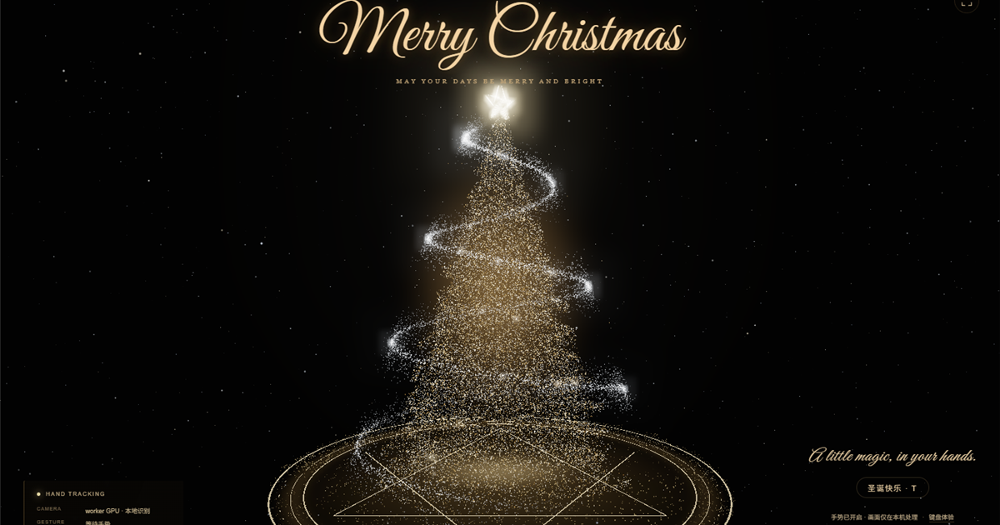

# 3D 虚拟现实交互式圣诞树

**3D VR Interactive Christmas Tree**

用一双手把星尘聚成一棵圣诞树。Three.js 金色粒子 + MediaPipe 本地手势识别，摄像头画面只在本机处理，模型、WASM、字体全部随包离线加载。

在线体验 → **<https://highlook.github.io/3d-vr-interactive-christmas-tree/>**



## 它能做什么

- **手势直接驱动画面**：比 1 / 2 / 3 出现粒子数字，OK 手势与三指同样走「数字 3 → 圣诞快乐」，握拳把当前星尘连续聚回成树，五指展开显示「天天开心」。
- **一切都在粒子层完成**：数字、中文祝福、金色飘带、树顶星共享同一套粒子系统，形态之间平滑变换，没有切换场景或淡入淡出的黑屏。
- **手机也能玩全套**：没给摄像头权限时，右下角「✋」展开手势按钮面板（数字 1/2/3、OK、握拳、五指、圣诞快乐、星尘重聚），效果与手势一致。
- **微信可直接分享**：内置提示引导「在浏览器打开」，支持添加到主屏幕，加进去以后全屏打开像 App。
- **离线可跑**：`public/` 里带着 Noto Sans SC 字体切片、MediaPipe WASM 与手部关键点模型，不依赖任何 CDN。

## 快速开始

```bash
# Node.js 22.12+；Chrome / Edge 等支持 WebGL2 的浏览器
npm ci
npm run dev
```

打开终端里的 localhost 地址即可。网页加载后会自动申请摄像头权限，允许后自动开始本地手势识别；拒绝权限也能用键盘或手机按钮继续玩。

Windows 上也可以直接双击 `启动源码版.bat`（首次自动 `npm ci`），或 `创建桌面快捷方式.bat` 生成一个指向 `release/site` 成品页的桌面入口。

## 操作对照

| 手势 | 键盘 | 结果 |
|---|---|---|
| 单指 | `1` | 数字 1 |
| 两指 | `2` | 数字 2 |
| 三指 | `3` | 独立数字 3，1 秒后切换「圣诞快乐」 |
| OK（拇指与食指接近，其余手指随意） | `O` | 同三指 |
| 握拳 | `F` / `R` | 从当前粒子位置连续汇聚成树 |
| 五指展开 | `空格` | 「天天开心」，停留后回到树 |
| — | `T` | 直接显示「圣诞快乐」 |
| 鼠标左键 / 单指拖动 | — | 只绕 Y 轴水平旋转；松手有惯性，约 3 秒后恢复慢速自转 |

手机上还能点右下角「✋」打开按钮面板，等价于上表的手势。

## 技术实现

**渲染（Three.js 0.170）**

- 单一 `ParticleTreeGroup` 承载树体、12,000 点飘带与树顶星；数字是独立的 2,400 点粒子层，不借用树体粒子。
- 树体/飘带/顶星共享文字轮廓并同时开始聚合；中文用逆树组矩阵保持正立，旋转树体不会带动文字。
- 六芒星地台、三层慢转圆环、半透明柔光盘、5,200 颗独立慢闪星空、260 点 GPU 飘雪，以及 UnrealBloom 后期；文字与树模式平滑调整 Bloom 强度。
- 实测约 5.1 万粒子，FPS 低于阈值时自动降分辨率而不是停动画。

**手势（MediaPipe Tasks Vision）**

- 视频帧进 Worker 做 `createImageBitmap` 推理，主线程不阻塞；Worker 初始化失败自动回退主线程，GPU 失败回退 CPU。
- `gestureConfig.ts`：160ms 确认窗、0.75 投票比例、200ms 冷却、至少 3 个独立帧，推理上限 30Hz（该置信度是时间窗投票比例，不是编造的模型概率）。
- `classifier.ts`：掌宽归一化、OK 优先、边沿检测、稳定释放重置、异常时间戳与重复帧过滤。

**交互与状态**

- `AnimationStateMachine.ts` 管理全部形态迁移：OK/三指统一为 NUMBER_3，事件发出 1 秒后切文字，新输入取消旧定时。
- 数字切换会捕捉当前坐标做受控弧线舒展（X 方向最大 0.38 世界单位），结束精确落回目标，不会跳变。
- 指针捕获 + 阻尼 + 空闲自转，垂直倾角固定为 0。

**可调参数**

- `src/config/gestureConfig.ts`：`gestureConfirmMs`、`gestureConfidenceThreshold`、`gestureCooldownMs`、`gestureStableFrames`
- `src/config/particleConfig.ts`：`textParticleSpacing`（Canvas 采样步长）、`textParticleDensity`、`textParticleSize`、`textGlowIntensity`、`textBloomStrength`，默认 4 / 0.34 / 3.6 / 2.0 / 0.72

## 目录结构

```
.
├─ src/
│  ├─ three/        场景、粒子、文字、星空、后期与状态机
│  ├─ gestures/     MediaPipe 手部关键点、Worker、手势分类
│  ├─ components/   页面与 HUD
│  └─ config/       手势与粒子参数
├─ public/          字体切片、WASM、手部模型、图标、微信增强层
├─ tests/           单元测试（Vitest，79 条）
├─ e2e/             Playwright 端到端用例（含并发与触摸）
├─ scripts/         构建前资源准备
├─ release/         免源码交付包（site/ 为构建产物）
└─ .github/workflows/pages.yml   推 main 自动构建并发布 Pages
```

## 构建与部署

```bash
npm run build     # 输出 dist/，base 为 "./"，可放根目录或任意子路径
npm test          # 79 条单元测试
npm run test:e2e  # Playwright，默认使用本机 Edge
```

- **GitHub Pages**：推送到 `main` 后由 `.github/workflows/pages.yml` 自动 `npm ci` → 测试 → 构建 → 部署，无需手工上传。
- **任意静态托管**：把 `dist/` 上传到 Cloudflare Pages / Netlify / Vercel / 对象存储均可。`release/` 里另有免源码交付包（`site/` 成品 + 本机启动脚本 + 使用说明），适合直接发给不想碰源码的人。
- **摄像头只认安全上下文**：必须 `https://` 或 `localhost`。局域网 `http://192.168.x.x` 会开页面但拿不到摄像头，这是浏览器规则，不是项目限制。

## 微信分享

微信内置浏览器对摄像头和 WebGL 的支持不稳定，页面会主动提示：

> 点右上角「···」→「在浏览器打开」（iPhone 是「在 Safari 中打开」），再允许摄像头即可。

相关实现都在 `public/wechat-enhance.js` 与 `public/wechat-enhance.css`：微信内提示、手机手势面板、以及 `manifest.webmanifest` 带来的「添加到主屏幕」。它们只复用页面已有的键盘事件，不改动渲染逻辑。

## 测试与已知限制

- 单元测试 79 条，覆盖形态迁移、粒子目标、文字布局、手势分类、并发与清理。
- Playwright 用虚拟视频流跑真实模型与 WASM 推理，截图产物在本地 `artifacts/`（未入库）。
- 真实光照下的手势准确率与端到端延迟需要真人验收；低端机建议直接用手势按钮。

## 许可

字体与依赖的开源许可保留在 `licenses/`：Great Vibes、Noto Sans SC（SIL OFL 1.1），React、Three.js（MIT）。MediaPipe 手部模型与 WASM 来自 `@mediapipe/tasks-vision`，遵循其上游许可。
